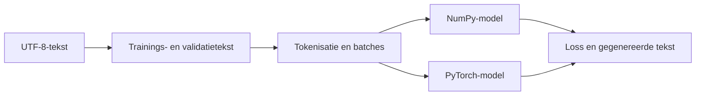

# Architectuur

Ik bouw twee implementaties in één Python-pakket. Het gemeenschappelijke deel gebruikt de standaardbibliotheek voor tekstinvoer, tokenisatie en gedeelde afspraken over evaluatie. Iedere variant zet de tokens om naar eigen arrays of tensors en verzorgt zelf de modelberekeningen en training.

## Eerste model

De tokenizer zet ieder teken om naar een geheel getal. Voor het bigrammodel is het invoerteken de enige context. Het doel is het volgende teken. De gewichten vormen een tabel met vorm `(V, V)`, waarbij `V` het aantal tokens is. Voor een batch van `B` invoertekens heeft de uitvoer vorm `(B, V)`. De loss meet hoe waarschijnlijk het model de juiste volgende tekens vindt. Bij genereren kies ik een volgend token uit de kansverdeling en gebruik dat als nieuwe invoer.

Ik gebruik Shakespeare-tekst uit `data/shakespeare.txt` als gedeeld UTF-8-corpus voor beide varianten. Ik bewaar hoofdletters, leestekens en regelafbrekingen. Voor de bevestigde bigramproef selecteer ik de eerste 10.000 tekens en splits ik na 9.000 tekens. De tokenizer bevat 57 tokens inclusief ID `0`. NumPy en PyTorch gebruiken dezelfde selectie en splits. Ik splits de tekst vóór tokenisatie en vóór het maken van trainingsparen en bouw de woordenschat uitsluitend met de trainingssplit. Onbekende tekens krijgen ID `0`. Ik houd trainings- en validatieloss apart. Kleine teksten zoals `abab` blijven afzonderlijke controles van de berekeningen. Het doel is Shakespeare-achtige tekst te genereren; de modellen leren daarvoor steeds het volgende teken te voorspellen.

## Uitbreiding naar een Transformer

Een kleine Transformer krijgt een context van meerdere tekens. Ik voeg token- en positie-embeddings, causale aandacht en feed-forwardlagen toe. Het causale masker voorkomt dat het model bij een voorspelling latere tokens ziet. In NumPy werk ik de afgeleiden per bouwsteen uit en controleer ik die op kleine voorbeelden met eindige verschillen. In PyTorch vergelijk ik uitvoer en loss met de NumPy-versie op dezelfde kleine invoer en gewichten.

Mijn huidige Transformer-bouwstenen staan in `src/jarvis/transformer_numpy.py`:

| Functie | Invoer en uitvoer |
| --- | --- |
| `token_embeddings` | Tabel `(V, D)` en ID’s `(B, T)` geven vectoren `(B, T, D)`. |
| `add_position_embeddings` | Ik tel de eerste `T` positierijen `(T, D)` bij de tokenvectoren op, met dezelfde posities voor iedere reeks. |
| `attention_projections` | Ik projecteer `(B, T, D)` met drie tabellen `(D, H)` naar queries, keys en values `(B, T, H)`. |
| `attention_scores` | Ik bereken `Q @ K.swapaxes(-1, -2) / sqrt(H)`, met uitvoer `(B, T, T)`. De testuitkomst is nog niet bevestigd. |

Hier zijn `B` de batchgrootte, `T` de reekslengte, `V` het aantal tokens, `D` de embeddingdimensie en `H` de vectorlengte binnen één aandachtkop. Het causale masker, de softmax over aandachtsscores en het mengen van values zijn nog niet gebouwd. De huidige bouwstenen vormen nog geen volledige Transformer.

Broncode komt in `src/jarvis/` en tests in `tests/`. Modelmodules ontstaan per mijlpaal. Lokale datasets en trainingsuitvoer krijgen respectievelijk de mappen `data/` en `runs/`.
