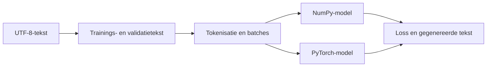

# Architectuur

Ik bouw twee implementaties in één Python-pakket. Het gemeenschappelijke deel gebruikt de standaardbibliotheek voor tekstinvoer, tokenisatie en gedeelde afspraken over evaluatie. Iedere variant zet de tokens om naar eigen arrays of tensors en verzorgt zelf de modelberekeningen en training.

## Eerste model

De tokenizer zet ieder teken om naar een geheel getal. Voor het bigrammodel is het invoerteken de enige context. Het doel is het volgende teken. De gewichten vormen een tabel met vorm `(V, V)`, waarbij `V` het aantal tokens is. Voor een batch van `B` invoertekens heeft de uitvoer vorm `(B, V)`. De loss meet hoe waarschijnlijk het model de juiste volgende tekens vindt. Bij genereren kies ik een volgend token uit de kansverdeling en gebruik dat als nieuwe invoer.

Ik begin met een kleine, zelfgeschreven UTF-8-tekst. Ik splits die vóór het maken van trainingsparen en bouw de woordenschat met de trainingssplit. Onbekende tekens krijgen een vaste token-ID. Ik houd trainings- en validatieloss apart.

## Uitbreiding naar een Transformer

Een kleine Transformer krijgt een context van meerdere tekens. Ik voeg token- en positie-embeddings, causale aandacht en feed-forwardlagen toe. Het causale masker voorkomt dat het model bij een voorspelling latere tokens ziet. In NumPy werk ik de afgeleiden per bouwsteen uit en controleer ik die op kleine voorbeelden met eindige verschillen. In PyTorch vergelijk ik uitvoer en loss met de NumPy-versie op dezelfde kleine invoer en gewichten.

Broncode komt in `src/jarvis/` en tests in `tests/`. Modelmodules ontstaan per mijlpaal. Lokale datasets en trainingsuitvoer krijgen respectievelijk de mappen `data/` en `runs/`.
