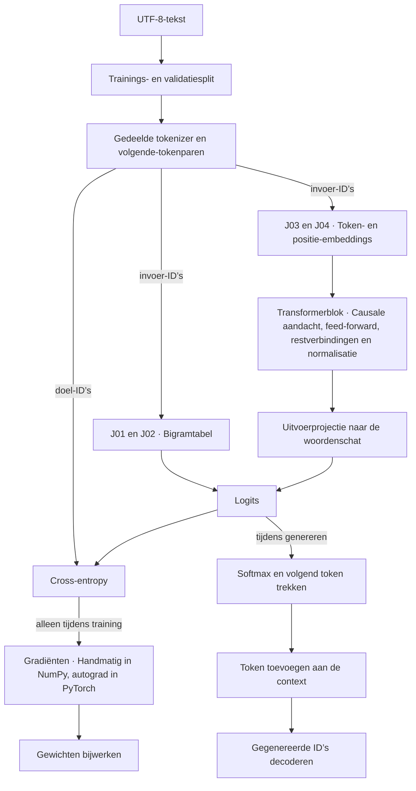

# Theorie van het taalmodel

Ik train Project JARVIS om het volgende token in een tekst te voorspellen. Ik begin met een bigrammodel dat één teken als context gebruikt. Daarna bouw ik een kleine causale Transformer die meerdere eerdere tekens kan gebruiken.

Tijdens het genereren voer ik na iedere trekking de bijgewerkte context opnieuw aan het model. Het bigrammodel leest alleen het nieuwste token. De Transformer leest meerdere tokens binnen zijn contextvenster.

## Mijn trainingsdoel — Shakespeare-achtige tekst

Ik gebruik Shakespeare-tekst uit `data/shakespeare.txt` voor beide varianten. Mijn tokenizer blijft op tekenniveau werken: ook spaties, leestekens en regelafbrekingen zijn tekens met een token-ID. Zo kan het model patronen in woorden, personagenamen en dialogen leren.

Het bigrammodel gebruikt alleen het laatste teken en leert dus lokale tekenovergangen. De Transformer krijgt meerdere voorafgaande tekens en kan langere patronen leren. Hoe herkenbaar de gegenereerde tekst wordt, hangt af van de modelgrootte, contextlengte en training. Ik beoordeel dit met apart gehouden validatietekst en voorbeeldgeneraties.

Voor mijn bevestigde bigramproef gebruik ik de eerste 10.000 tekens van het corpus, met de eerste 9.000 voor training en de volgende 1.000 voor validatie. Beide varianten gebruiken deze selectie en splitgrens. Ik splits vóór tokenisatie en bouw de woordenschat alleen op de trainingssplit. De kleine handvoorbeelden blijven mijn controles van losse bouwstenen.

## J01 — Van tekens naar voorspellingen

### Tokenisatie en volgende-tokenparen

Ik splits de tekst eerst in training en validatie. Uit de trainingstekst haal ik de unieke tekens, die ik sorteer en vanaf ID `1` nummer. ID `0` reserveer ik voor onbekende tekens. Met trainingstekst `abac` wordt `a → 1`, `b → 2` en `c → 3`. Ik gebruik diezelfde koppelingen voor validatie en generatie. Bij het decoderen zie ik `�` waar een onbekend token staat.

Per split gebruik ik alle token-ID’s behalve de laatste als invoer en alle ID’s behalve de eerste als doel. Bij `abac` geeft `[1, 2, 1, 3]` dus invoer `[1, 2, 1]` en doelen `[2, 1, 3]`. Het doel op elke positie is het token één positie verder in de oorspronkelijke tekst.

### Logits, softmax en loss

Ik gebruik een tabel met vorm `(V, V)`, waarbij `V` het aantal token-ID’s is, inclusief ID `0`. De huidige ID kiest een rij. Iedere kolom geeft een score voor een mogelijk volgend token. In de code levert `weights[input_ids]` voor `B` voorbeelden een array met vorm `(B, V)`.

Softmax zet de scores, of logits, om in kansen. Ik neem per rij de exponent van elke score en deel die door de som van de exponenten. Bij logits `[0, ln(2), 0]` krijg ik kansen `[1/4, 1/2, 1/4]`. De loss voor een voorbeeld is `−ln(p)`, waarbij `p` de kans op het juiste token is en `ln` de natuurlijke logaritme. Voor doel-ID `1` krijg ik dus `−ln(1/2) ≈ 0,693`.

In `cross_entropy` trek ik eerst het maximum van elke rij af om de exponenten stabiel te berekenen. Daarna trek ik de verschoven logit van het doel af van de logaritme van de som van de exponenten. Dat geeft dezelfde loss als `−ln(p)`. Ik neem het gemiddelde over de voorbeelden.

### Gradiënten, training en generatie

In NumPy bereken ik per voorbeeld de gradiënt van de gemiddelde loss naar iedere logit. Ik begin met de softmaxkansen, trek bij de doelkolom `1` af en deel alle bijdragen door `B`. Met drie gelijke kansen en doel-ID `1` levert dat vóór het delen `[1/3, −2/3, 1/3]` op. Als twee voorbeelden dezelfde invoer-ID hebben, tel ik hun bijdragen met `np.add.at` op in dezelfde gewichtenrij. Ik werk de gewichten bij door de gradiënt maal de leersnelheid af te trekken.

Voor een controle met eindige verschillen verander ik één gewicht naar boven en naar beneden en bereken ik in beide gevallen de loss. Het verschil tussen die losses gedeeld door de afstand tussen de twee gewichtswaarden benadert de afgeleide voor dat gewicht.

Tijdens generatie zet ik de logits voor het laatste token om in kansen en trek ik daaruit een nieuw token. Ik voeg dat token toe aan de reeks en gebruik het voor de volgende voorspelling. Met dezelfde gewichten, start-ID en seed kon ik mijn NumPy-voorbeeld herhalen.

## J02 en J04 — Wat PyTorch verandert

Ik houd de tokenizer, splits, doelen en modelberekening gelijk. In het bigrammodel levert dezelfde tabelindexering met dezelfde gewichten en invoer dezelfde logits op. Cross-entropy meet in beide varianten dezelfde gemiddelde loss. Voor J02 vergelijk ik die waarden eerst op vaste invoer en gewichten.

In mijn PyTorch-functie geef ik de logits rechtstreeks aan `torch.nn.functional.cross_entropy`, met `reduction="mean"`. Ik pas vooraf geen softmax toe: de functie berekent intern de benodigde logkansen. De invoer heeft vorm `(B, V)`, de doel-ID’s hebben vorm `(B,)` en type `torch.long`. De loss blijft een scalaire tensor met vorm `()`, zodat autograd er later op kan terugrekenen. Voor weergave kan ik met `.item()` het getal uit die tensor halen.

In NumPy schrijf ik zelf uit hoe de loss via de logits afhangt van de gewichtentabel. In PyTorch werk ik met tensors. Wanneer de gewichtentensor gradiënten bijhoudt, volgt autograd de bewerkingen waarmee ik de loss bereken. Een aanroep van `loss.backward()` past de kettingregel toe tot aan de gewichten. Daarbij telt PyTorch ook bijdragen op wanneer meerdere voorbeelden dezelfde rij hebben gelezen. Dat is dezelfde optelling die ik voor het NumPy-bigrammodel met `np.add.at` uitvoer.

Met `requires_grad=True` laat ik autograd de bewerkingen voor mijn gewichtentensor volgen. In mijn controle met twee voorbeelden die rij 1 lezen, telt autograd de bijdragen op tot `[1/3, -1/6, -1/6]`. `loss.backward()` berekent die gradiënten, maar wijzigt de gewichten niet.

De gewichtenupdate blijft een aparte stap. Voor elke trainingsstap maak ik eerder opgebouwde parametergradiënten leeg, bereken ik de nieuwe loss en laat ik autograd de nieuwe gradiënten bepalen. Daarna gebruik ik die gradiënten om de gewichten bij te werken. In mijn trainingsfunctie maak ik met `weights.detach().clone().requires_grad_(True)` een onafhankelijke trainbare kopie. Per stap zet ik `.grad = None`, bereken ik loss en gradiënten, controleer ik met `assert gradients is not None` dat de gradiënten aanwezig zijn en voer ik de update uit binnen `torch.no_grad()`. De update is `W_nieuw = W_oud - learning_rate * gradient`. Aan het einde geef ik de gewichten met `.detach()` terug. Het wissen voorkomt dat PyTorch gradiënten van opeenvolgende stappen optelt.

Bij generatie schakel ik autograd uit met `@torch.no_grad()`. Ik lees de laatste gewichtenrij, bereken softmax en trek met `torch.multinomial` een token. Een eigen CPU-generator met seed maakt de uitvoer binnen mijn omgeving herhaalbaar. Een gelijke seed geeft niet noodzakelijk dezelfde tekst als NumPy. ID `0` behoudt een kans en kan als `�` in de uitvoer verschijnen.

Bij de PyTorch-Transformer neemt autograd later ook de kettingregel door aandacht, feed-forwardlagen en normalisatie over. Voor de NumPy-Transformer moet ik die afgeleiden nog zelf bouwen en controleren.

## J03 — Van één teken naar een context

Ik geef de Transformer een reeks tokens. Een token-embedding geeft elke ID een vector en een positie-embedding geeft elk positie-index een vector. Ik tel die vectors op, zodat de representatie informatie bevat over zowel het teken als zijn plaats.

### Token- en positie-embeddings

Mijn token-embeddingtabel heeft vorm `(V, D)`. De ID-array heeft vorm `(B, T)` en `embedding_table[input_ids]` levert `(B, T, D)`. Hier zijn `V` de woordenschatgrootte, `D` de vectorlengte, `B` het aantal reeksen en `T` hun lengte. De kolommen zijn interne vectorcomponenten; bij de bigramtabel waren het direct logits voor volgende tokens.

Ik tel bij iedere tokenvector de positievector op: `X[b, t, d] = E[input_ids[b, t], d] + P[t, d]`. `E` is de tokentabel, `P` de positietabel en `d` een vectorcomponent. Ik selecteer `position_table[:T]` met vorm `(T, D)`; NumPy past die door broadcasting op iedere reeks toe. De functie ondersteunt voorlopig reeksen waarvoor voldoende positierijen beschikbaar zijn. De voorbeeldgewichten zijn handgekozen; tijdens volledige training worden ze trainbaar.

### Queries, keys, values en aandachtsscores

Ik maak voor één aandachtkop drie projecties: `Q = X @ W_Q`, `K = X @ W_K` en `V_values = X @ W_V`. De queries beschrijven waarmee een positie zoekt, de keys waarmee posities worden vergeleken en de values welke informatie wordt doorgegeven. De drie gewichtentabellen hebben vorm `(D, H)` en de uitvoer heeft vorm `(B, T, H)`, waarbij `H` de vectorlengte binnen de kop is. `V_values` staat hier voor values; de letter `V` in de woordenschatvormen betekent woordenschatgrootte.

`@` betekent matrixvermenigvuldiging. Met queries `[[1, 2], [3, 4]]` en keys `[[2, 1], [4, 3]]` krijg ik de ongeschaalde scores `[[4, 10], [10, 24]]`. Ik deel door `sqrt(H)`, hier `sqrt(2)`, om groei van scores bij langere vectoren te beperken. In mijn code staat `queries @ keys.swapaxes(-1, -2) / np.sqrt(head_size)`. `swapaxes` verwisselt de laatste twee assen van keys en behoudt de batchas.

De score-uitvoer heeft vorm `(B, T, T)`: per reeks geeft rij `t` de scores waarmee positie `t` naar iedere positie `s` kijkt. Dit zijn nog geen kansen. De code en scoretest zijn toegevoegd, maar ik heb de testuitkomst nog niet bevestigd. Het causale masker, de softmax over bekeken posities en het gewogen mengen van values volgen daarna.

Causale aandacht laat elke positie informatie ophalen uit zichzelf en eerdere posities. Als de invoer `a b c` is, mag de positie van `b` aandacht geven aan `a` en `b`. De score voor aandacht naar `c` wordt gemaskeerd, zodat `b` bij het voorspellen van `c` het antwoord niet vooraf ziet. Ik controleer dit straks door een toekomstig invoertoken te wijzigen en te vergelijken of de eerdere logits gelijk blijven.

De feed-forwardlaag verwerkt de vector op iedere positie afzonderlijk. Restverbindingen tellen de invoer van een deelbewerking op bij de uitvoer. Normalisatie helpt de schaal van de activaties te beheersen. De uitvoerprojectie levert voor elke positie een score per mogelijk volgend token. Bij `B` reeksen met elk `T` posities heeft die uitvoer vorm `(B, T, V)`. Ik gebruik weer cross-entropy op de juiste volgende-token-ID’s.

## J05 — De varianten vergelijken

Ik gebruik voor elke vergelijking dezelfde tokenizer, datasplits, contextlengte en meetmethode. Ik vergelijk onder meer validatieloss, CPU-trainingsduur en gegenereerde tekst. De daling van de trainingsloss op `abab` is mijn eerste controle dat de NumPy-trainingslus leert op de gekozen voorbeelden. De validatiesplit gebruik ik om te meten hoe goed de voorspellingen werken op apart gehouden tekst.
